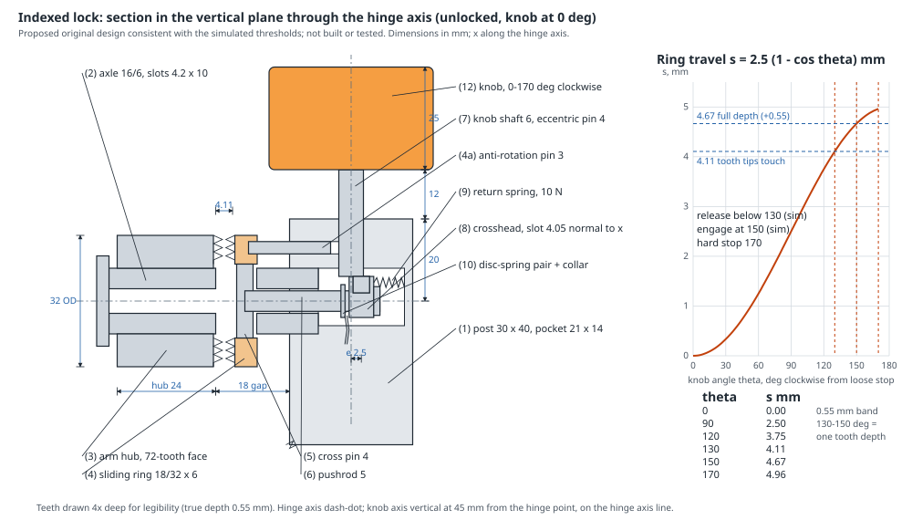

# Aim a loaded inspection arm and lock it at the set angle

Setting up an inspection or camera fixture often takes two hands. One hand holds a loaded adjustable arm at
the required angle against gravity, and the other tightens the arm's clamp. The setting must then hold after
both hands let go. Here, one YAM gripper supports the arm's head at +15 degrees while the other turns the
clamp knob on the post. The task checks that the elevation is retained after both grippers withdraw.

What is evaluated is the arm's elevation and that it holds. No camera image from the inspection head is
evaluated.

The task is a task-local plugin for the `yam_arena` adapter of
[yam-isaac-lab-arena](https://github.com/kairosiann/yam-isaac-lab-arena) (YAM arms at the calibrated `station`;
Isaac Lab-Arena 0.3.1 / Isaac Lab 3.0 / Isaac Sim 6.1). It adds the embodiment `yam_inspection_mount`, which
builds the fixture, its joints and the clamp model on top of the unchanged robot, cameras and 14-D joint
action/observation contract of `yam_arena`. It also adds the scripted demonstration policy `mount_scripted`.

## Setup

Coordinates: x forward from the line between the two arm bases, y to the left, from the midpoint between the
bases; heights above the table top. Elevation is the arm's angle above horizontal; positive raises the head.

| Part | Size | Mass | Position |
|---|---|---|---|
| post, fixed | 3 x 4 cm, 14 cm tall, on a 10 x 8 x 0.6 cm foot plate | fixed | centred at (29.5, 8) cm |
| hinge (axis along x) | — | — | (25, 8) cm, 12 cm high |
| arm bar | 1.6 x 1.2 cm, from the hinge toward -y | 60 g | — |
| inspection head (black block, orange lens) | 4 x 6 x 3.5 cm, centre 20 cm from the hinge axis | 250 g | — |
| clamp knob (orange), vertical axis | ridged round, 4 cm diameter, 2.5 cm tall, on a stem 1.2 cm above the post | 120 g | (29.5, 8) cm |

- **Start:** the arm rests on its lower stop, 26 degrees below horizontal, and the knob is loose. (The arm is
  spawned 25 degrees below horizontal and settles onto the 26-degree hinge limit before the first control step;
  the recorded demonstration reports -26.0 degrees from t = 0.05 s.)
- **Hinge travel:** −26 to +45 degrees.
- **Target:** +15 degrees. The head centre is then 5.2 cm above the hinge axis, 17.2 cm above the table, so the
  setting can be checked with a ruler.

For physical reconstruction, use a rigid metal post and foot plate, a lightweight hollow metal arm,
and a polymer dummy head ballasted to the stated mass; the knob is die-cast metal. These specify an
original analogue, not a calibrated commercial fixture. Simulation masses and friction are authored.

## Instruction

The text instruction is the `instruction` field of `task.json`:

1. Support the head.
2. Swing the arm to +15 degrees.
3. Keep the aim while the other gripper tightens the knob clockwise to its stop. Loosen it first if the arm is
   locked elsewhere.
4. Open both grippers and withdraw.
5. The arm must stay at +15 degrees on its own.

## Clamp model (declared, reduced-order)

- **Unlocked hinge:** an ideal revolute joint with no friction, so the loaded arm falls to its lower stop when
  released.
- **Knob:** a revolute joint about z.
  - Viscous damping 2e-4 N m s/deg, capped at 0.5 N m.
  - Stops at 0 (loose) and 170 degrees clockwise. The 170-degree stop is this prototype's chosen travel limit.
- **Indexed lock:** a 72-tooth face-serration lock with 5-degree steps; the physical linkage is specified in
  [Indexed lock](#indexed-lock) below.
  - Engages once the knob has been turned at least 150 degrees clockwise. The teeth mesh at the tooth nearest the
    arm's current angle.
  - Modelled as an angular spring to that tooth angle: 2 N m/deg, damping 0.02 N m s/deg, torque capped at 20 N m.
  - Turning the knob back below 130 degrees disengages it.
- **What triggers the lock:** only the knob's measured rotation. Nothing depends on the goal, a timer or the
  script phase, and nothing is teleported.
- **Limits of the model:**
  - The 20 N m cap is an authored simulation parameter, not a measured tooth strength.
  - Tooth shear, wear and breakage are not simulated.
  - The clean free-or-meshed transition is an idealisation: real serrated joints can have some drag before they
    mesh.

## Indexed lock

This is a **proposed original design, consistent with the simulated thresholds. It has not been built or
tested**, and it is not a commercial part. It shows one reproducible way for the vertical knob to engage and
release the horizontal hinge with the knob travel the simulation uses.



**Geometry.** The knob's vertical axis (x = 29.5 cm, y = 8 cm) crosses the hinge axis (y = 8 cm, 12 cm high)
inside the post, 20 mm below the post top. The 45 mm offset between the knob and the hinge point therefore runs
*along* the hinge axis, and a straight pushrod inside the hinge axle can join them. The arm hub
(32 mm diameter, x 23.8-26.2 cm) leaves an 18 mm gap to the post's -x face (x 28.0 cm) for a sliding ring.

| # | Part | Material, key dimensions | Function |
|---|---|---|---|
| 1 | Post | Steel, 30 x 40 x 140 mm; 6 mm vertical bore on the knob axis; 16 mm horizontal bore on the hinge axis; internal pocket 21 x 14 mm (x 287-308 mm) at hinge height; 3 mm anti-rotation hole | Frame; carries all reactions to the foot plate |
| 2 | Hinge axle | Steel tube 16 mm OD, 6 mm bore, pressed 7 mm into the post, through the hub to a retaining collar; two slots 4.2 x 10 mm in the gap (x 262-272 mm) | Hinge pin; guides the pushrod |
| 3 | Arm hub | Steel, 32 mm OD x 24 mm; on its +x face a 72-tooth face serration, annulus 18-32 mm diameter, 90-degree included tooth angle | Rotating half of the lock |
| 4 | Sliding ring | Hardened steel, 18/32 mm x 6 mm; matching 72-tooth face toward the hub; 3 mm anti-rotation pin (4a) sliding in the post | Non-rotating half of the lock; slides along x |
| 5 | Cross pin | Steel, 4 mm x 18 mm, through the axle slots and the ring | Couples the pushrod to the ring |
| 6 | Pushrod | Steel, 5 mm, inside the axle bore from the cross pin to the pocket; collar and nut at its end | Transmits axial travel |
| 7 | Knob shaft | Steel, 6 mm, from the knob down to hinge height; 4 mm eccentric pin at its lower end, eccentricity e = 2.5 mm | Scotch-yoke crank |
| 8 | Crosshead | Steel block 6 mm along x, with a 4.05 mm slot normal to x that holds the eccentric pin | Turns knob rotation into travel along x |
| 9 | Return spring | Extension spring, about 10 N, crosshead to pocket +x wall | Keeps the ring clear of the teeth when loose and removes backlash |
| 10 | Disc-spring pair | Between collar and crosshead; about 0.3 mm stroke to solid, about 60 N preload at the stop | Absorbs the 150-170 degree overtravel; sets the clamp preload |
| 11 | Knob detent | Spring ball under the knob, seating at the 170-degree stop | Holds the tightened knob |
| 12 | Knob | Die-cast, 40 mm x 25 mm, 120 g; stops at 0 and 170 degrees clockwise | Operator input (the existing simulated knob) |

**Knob travel to lock and unlock.** Turning the knob clockwise by θ from its loose stop moves the crosshead, pushrod
and ring toward the hub by s(θ) = e (1 - cos θ) with e = 2.5 mm. In the unlocked position the tooth tips are
4.11 mm apart.

| Knob θ | 0 | 90 | 120 | 130 | 150 | 170 (stop) |
|---|---|---|---|---|---|---|
| Ring travel s, mm | 0 | 2.50 | 3.75 | 4.11 (tips touch) | 4.67 (full depth) | 4.96 |

- **Lock:** turn clockwise to at least 150 degrees (full tooth depth); the 170-degree stop and the detent hold it.
  The simulation engages at 150 degrees.
- **Unlock:** turn back below 130 degrees; the tips clear and the return spring keeps the ring off the hub. The
  simulation releases below 130 degrees.
- **Overtravel:** 150 to 170 degrees adds 0.30 mm, taken by the disc springs, and leaves the crank 10 degrees short
  of dead centre.

**Tooth geometry.** 360 / 72 = 5 degrees per tooth. On the 12.5 mm mean radius the pitch is
2π x 12.5 / 72 = 1.09 mm; a 90-degree tooth is pitch / 2 = 0.55 mm deep, which equals the 130-150 degree travel
band (4.67 - 4.11 = 0.56 mm). The flanks centre the arm on the nearest tooth, at most 2.5 degrees away. Fine
72-tooth face serrations are a machined (wire-EDM or broached) part.

**Force path.** Arm load → hub teeth → ring. From the ring, the tangential force goes through the anti-rotation
pin into the post; the axial (separating) force goes through the cross pin, pushrod, collar, disc springs,
crosshead and eccentric pin into the knob shaft, whose bearing is in the post.

| Quantity | Value |
|---|---|
| Arm load torque at +15 degrees (60 g bar, centre at 10 cm; 250 g head at 20 cm) | 0.53 N m |
| Tangential and axial tooth force at that torque (12.5 mm radius, 45-degree flanks) | 42 N each |
| Knob back-drive torque at the stop (60 N preload + 10 N spring, x e x sin 170°) | 0.03 N m, held by the detent |
| Knob torque to tighten, peak (near 165 degrees) | about 0.04 N m |
| Axial force at 5 N m; cross-pin shear (single shear, 4 mm) | 400 N; 32 MPa |
| **Rated holding torque** | **5 N m**, about 9 x the arm load |

The rating is a hand calculation for this proposed design. Above the 60 N preload, the disc springs reach solid
after less than 0.1 mm, well short of the 0.55 mm tooth depth, so the teeth cannot ratchet below the rating.
**The simulation's 20 N m torque cap is a solver parameter, not a strength rating**; at 20 N m this design would
put 127 MPa on the cross pin and is not rated for it.

**What the simulation abstracts.**

- The linkage (crank, crosshead, pushrod, ring, springs, detent) is reduced to the knob's measured angle → engaged
  state, with hysteresis: engaged at 150 degrees or more, released below 130 degrees.
- The teeth are an angular spring and damper to the nearest 5-degree tooth, with no tooth contact. Partial mesh
  between 130 and 150 degrees, which a real lock would show as drag, is not modelled.
- The knob is a viscous-damped joint; no tooth or spring reaction is fed back into it.
- None of the internal parts are rendered or collide; the visible axle stub stops short of the hub (cosmetic).

## Scoring

Implemented in `mount_aim/scoring.py` and reported as `info["score"]` for `--scorer task_score`. Every input
is measured:

- elevation, from the arm body's pose;
- the lock state, from the knob's rotation;
- each gripper's finger opening and its TCP distance to the head and knob centres.

| Score | Condition |
|---|---|
| 0.25 | the head has been raised within 10 degrees of +15 |
| 0.5 | the head has been within 3 degrees of +15 |
| 0.75 | while the lock is meshed with the arm within 3 degrees |
| 1.0, success, trial ends | meshed and within 3 degrees; both grippers at least 80 % open with TCPs at least 7 cm from the head and knob centres; all of this holding for 2 s with elevation deviating no more than 2 degrees from its value at the start of that window |

- Non-finite states score 0 for that step and restart the window.
- The untouched start scores 0.
- An arm locked at the wrong angle scores 0, unless it was raised near the target earlier.

CPU checks (no simulator): `python -m pytest tests` in this folder. They cover:

- the untouched start;
- a wrong angle, locked;
- the right angle while still held;
- an unlocked release;
- a full stable release;
- drift, out-of-tolerance angles and non-finite states.

## Running

Needs Linux with an NVIDIA RTX GPU. Install the pinned adapter, which installs Isaac Lab-Arena and Inspect
Robots. From the repository root:

```bash
mkdir -p .deps
git clone https://github.com/kairosiann/yam-isaac-lab-arena.git .deps/yam-isaac-lab-arena
git -C .deps/yam-isaac-lab-arena checkout 0059d02a1a91bc6834c1d0846022891df0c78730
ARENA_DIR="$PWD/.deps/IsaacLab-Arena" .deps/yam-isaac-lab-arena/setup.sh
source .deps/IsaacLab-Arena/yam.env
export ISAACSIM_ASSET_ROOT=https://omniverse-content-production.s3-us-west-2.amazonaws.com/Assets/Isaac/6.0
uv pip install --no-deps -e tasks/inspection-mount   # registers yam_inspection_mount and mount_scripted
```

Scripted full-score demonstration. Run it from `tasks/inspection-mount`; the generated USD parts are written to
`assets/generated/`:

```bash
cd tasks/inspection-mount
inspect-robots run --embodiment yam_inspection_mount --policy mount_scripted \
  -E control_hz=20 -E cam_width=320 -E cam_height=176 \
  --instruction "$(python -c 'import json; print(json.load(open("task.json"))["instruction"])')" \
  --scorer task_score --max-steps 1200 --store-frames --log-dir runs/mount-demo
```

- **Other policies:** a policy under test runs the same command with its own `--policy`.
- **Telemetry:** `-E telemetry=<file.jsonl>` writes a per-step trace of the elevation, knob angle, lock state,
  gripper state and score.
- **Comparisons:** `-P mode=nolock` aims and releases without tightening; `-P mode=prelock` tightens first and
  then tries to aim.
- **Run limit:** 1,200 steps (60 s at 20 Hz).
- **Layout:** one fixed layout. There are no free objects, and `object_jitter` is 0.
- **Demonstration result:** `task_score` 1.0, with success after 344 steps (17.2 s simulated). A repeat after a
  reset, two epochs in one process, also scored 1.0 in both episodes.

The demonstration is privileged: it reads the simulator's part poses, and its commands still go through the
guide's IK as ordinary joint targets.

1. The right gripper pinches the head across the hinge axis and swings the arm up in four arc steps.
2. Meanwhile the left gripper snugs the knob with a first stroke, stopping at 120 degrees, short of the
   150 degrees at which the lock meshes. Once the head is at the aim it tightens the knob to its stop with a
   second stroke while the right gripper keeps the aim.
3. Both withdraw.

The script commands +19 degrees so that the position-controlled arm, sagging under the load, settles near +15.
Both the instruction and the scorer use the actual +15 degrees.

Comparisons in this model, from scripted runs:

- **Release before locking:** with the current fixture, the arm reaches +15.5 degrees, then falls back to
  its -26-degree lower stop after release; score 0.5 for having reached the aim.
- **Lock first, then aim with one gripper:** with the current fixture, the lock meshes at -25 degrees.
  The scripted attempt reaches only -19.6 degrees before slipping, then returns to -25.3 degrees on release;
  score 0.0. Both comparisons use the same mechanism and code as the full-score demonstration.

These support the cooperative role of the two arms for this mechanism. They do not prove every one-arm
strategy impossible.

## Simulation notes

- All parts are rigid primitives. The post is a kinematic body, and the foot plate is the task file's fixed
  object.
- Physics runs at 240 Hz and control at 20 Hz. The robot uses the adapter's default contact model.

## Media

Dream-1 (`dreamlabs/dream-1-beta`): one episode, seed 0, 1,200 steps, task_score **0.0**,
terminated at the step limit without errors. It used the same text instruction, fixture, cameras and
scorer as the demonstration. The scripted demonstration scored **1.0**, including a repeat after reset.

To reproduce the Dream evaluation (requires a funded Dream API account), use the demonstration command
with `--policy dream --epochs 1 --seed 0` and a separate log directory. This calls the paid API.

The submission includes the complete Dream video, full-score demonstration video and initial setup
image. The media ID is assigned on upload; the videos show the left wrist, right wrist and overhead
cameras side by side.
